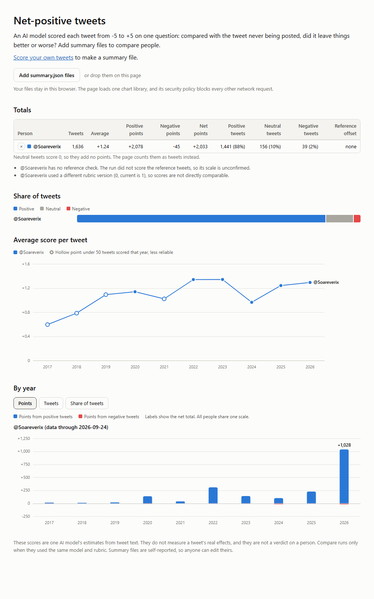

# Net-positive tweets

Score every tweet in your Twitter/X archive from -5 to +5, then compare your results with other people on a chart.

An AI model reads each tweet and answers one question: compared with this tweet never being posted, did it leave things better or worse? Every tweet gets a score, a confidence level and a one-line reason. Your yearly totals go into a small file with no tweet text. You can share that file to compare.



To see the page, download this repo and open `docs/index.html` in a browser. It includes one example account.

## Score your own tweets

You need Python 3.9 or newer. There are no packages to install and no API key to set up. If `python` is not found on your system, use `python3` in the commands below.

**1. Download your archive.** On X, go to Settings, then Your account, then Download an archive of your data. X usually takes a day or more to prepare it. You will get a zip file.

**2. Get this repo.**

```bash
git clone https://github.com/Michael-Andrzejewski/net-positive-tweets
```

**3. Score your tweets.** Pick one of these:

- **Claude Code:** open the repo folder and run `/score-tweets path/to/archive.zip`.
- **Another coding agent:** ask it to follow `.claude/skills/score-tweets/SKILL.md`.
- **Any AI chat, by hand:**
  1. Run `python scripts/prepare.py path/to/archive.zip`.
  2. For each file in `out/batches/`, paste `RUBRIC.md` and the batch into a chat. Save the reply in `out/labels/` under the same name, ending in `.jsonl`. For example, `batch_001.txt` needs `batch_001.jsonl`.
  3. Run `python scripts/check.py` and fix anything it reports.
  4. Run `python scripts/finish.py --name "@yourhandle" --model "the model you used"`.

**4. See the chart.** Open `docs/index.html` and add `out/summary.json`.

## What you get

| File | What it holds | Share it? |
|---|---|---|
| `out/scores.csv` | Every tweet with its score, confidence and reason | No, keep it private |
| `out/summary.json` | Yearly totals, your chosen name and the model name. No tweet text. | Yes, this is the only file to share |
| Everything else in `out/` | Batches, images and a copy of your tweets | No, keep it private |

The summary holds, for each year, positive points, negative points, and counts of positive, neutral and negative tweets. Neutral tweets score 0, so they add no points. The page shows them as tweet counts.

In the CSV, a cell starting with `=`, `+`, `-` or `@` gets a leading apostrophe, so spreadsheet apps will not run it as a formula. This includes most replies.

## Compare with other people

Send each other your `summary.json` files and add them all to the page. It compares up to 8 people at once. You will see:

- A totals table.
- The share of positive, neutral and negative tweets.
- The average score per tweet, year by year.
- A chart for each person, showing points, tweets, or share of tweets per year.

Comparisons are only fair between runs with the same model and rubric. To check this, every batch also holds 14 invented tweets with fixed reference scores. `finish.py` prints OK or WARNING for each run, and the page warns you when a run lands far from the reference scores.

This check catches a run with a drifting scale. It does not catch cheating:

- Raters are not told which entries are reference tweets, but `scripts/anchors.json` is public and a rater could still find them.
- Summary files are self-reported, so anyone can edit theirs. Compare with people you trust.
- The reference scores come from this project's rubric author, so they are a shared standard and not a measure of truth.

In testing, a fresh agent scored 13 of the 14 reference tweets exactly and all 14 within 1 point. That is one run on one small archive.

The example account, @Soareverix, was scored with an earlier draft of the rubric, before the reference tweets existed. So its offset shows "none", and the page warns about the rubric version. Its 8 raters also scored 15 shared tweets, and they were never more than 1 point apart. Those raters were all the same model, so this shows consistency and not correctness.

## What it costs

The first full run scored 1,636 tweets in 8 batches and used about 1.4 million tokens with Claude Code. Two tests of 27 tweets used about 120,000 and 130,000 tokens, mostly agent overhead. The prepare script prints an estimate before you spend anything.

For a large account, score a random sample:

```bash
python scripts/prepare.py path/to/archive.zip --sample 2000
```

A sample keeps averages and shares comparable. Totals become estimates, and the page marks them.

If `out/` already has scores, the prepare script stops so you do not lose them. Adding `--force` deletes those scores and starts over.

## How far to trust the numbers

- **These are estimates.** A model judges each tweet from its text. Nothing here measures the real effects of a tweet.
- **Models have views.** The rubric tells raters to ignore their agreement with a tweet, but that may not fully work. This matters most for political tweets and for tweets about AI.
- **The positive share runs high.** Harmless friendly replies score +1, so most accounts will look mostly positive. Rankings within one account are more reliable than the overall percentage.
- **Context is missing.** Many replies are scored without their parent tweet, and quote tweets without the quoted text. Those scores usually have low confidence.
- **Longer tweets tend to score higher.** This could be real substance or a rater preference.
- **Images are partly covered.** Raters only see images for tweets with short captions.

A score is not a verdict on a person. The tool needs your own archive, so it only works on tweets from people who choose to run it.

## Privacy

- Your archive holds direct messages, contacts and login history. The scripts read only the tweet files, the account file and tweet images. A test confirms that other files stay unread.
- Scoring sends your tweet text to the AI you use, under that provider's terms.
- Your archive can include tweets you later deleted. Those are scored too, and they count toward your totals. The CSV marks them in its `deleted` column.
- `.gitignore` blocks `out/`, zip files and CSV files, so a normal commit will not include them.
- The comparison page runs in your browser and uploads nothing. It loads one pinned chart library from cdnjs, and its security policy blocks every other network request. It treats other people's summary files as untrusted input.

## Tests

```bash
python -m unittest discover tests
```

The tests use an invented archive and contain no real tweets.

## License

MIT. See [LICENSE](LICENSE).
